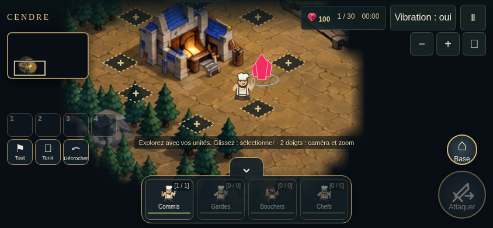

Performance : caches de rendu et banc 30 contre 30 (#17)

Le terrain du champ de bataille est conservé dans un canvas hors écran à la résolution d’affichage. Il est recalculé lors d’un changement de caméra, de zoom, de dimensions ou du chargement de l’image. Les sprites SVG des unités sont rasterisés par type, équipe et échelle d’affichage ; le changement d’échelle libère les anciens sprites pour borner la mémoire. Le brouillard ne repeint que les cellules dont la visibilité ou l’exploration change. La liste des unités visibles triée est partagée avec la minicarte.

La simulation partagée évite le tri de tous les ennemis pour chercher la cible la plus proche, écarte les paires sans collision avant le calcul de distance et limite les tests de vision aux cases proches des sources. Les règles de vision et la priorité des cibles à distance égale restent couvertes par les tests.

`/game/?debug=1` affiche les FPS et le temps de traitement d’une image, rendu compris. Le temps affiché exclut l’attente entre deux callbacks d’animation ; les FPS utilisent leur intervalle réel.

Vérifications effectuées :

- Chaque fichier `tests/*.mjs` exécuté avec Node, tous réussis.
- `node --check` sur tous les `public/game/*.js` et les deux scripts ajoutés, réussi.
- Tests supplémentaires : réutilisation et invalidation des caches, brouillard inchangé sans écriture, équivalence de visibilité case par case avec l’ancien algorithme, mémoire d’exploration, priorité des cibles, combat effectif avec 60 unités et ordre des listes de dessin.
- Chrome headless via Playwright, viewport 844×390, `Emulation.setCPUThrottlingRate({ rate: 4 })`, 600 images de chauffe puis 600 images mesurées à raison d’une simulation par callback d’animation. Les deux armées restent vivantes et visibles, avec des dégâts effectivement infligés.
- Dernière exécution isolée : moyenne **0,697 ms**, p95 **1,200 ms**, p99 **1,400 ms**, maximum **1,500 ms**, **0 image ≥ 4 ms**. [Rapport brut](benchmark.json). Des exécutions précédentes ont présenté des pointes au-delà de 4 ms ; le script conserve un seuil strict sur le maximum et retourne un échec dans ce cas.
- Le banc mesure simulation, filtrage/tri et préparation des caches avec de vrais canvas. Il isole ces opérations de la boucle de rendu du jeu ; il ne mesure pas le coût GPU ni ne prouve 60 FPS sur un téléphone.
- Vérification navigateur de `?debug=1`, démarrage solo, zoom avant/arrière et redimensionnement, sans exception JavaScript.

Captures avant/après en 844×390, temps de simulation figé pour comparer la même scène. Le rendu avant provient de `1acbbe608063ebe4590f2f5b6547c17d3b0effe8`. Inspection visuelle sans régression constatée ; les écarts de rasterisation concernent 0,32 % des pixels.

| Avant | Après |
| --- | --- |
|  |  |

Reproduction depuis la racine du dépôt, Node et Chromium disponibles :

```sh
npm install --prefix /tmp/cendre-render-tools playwright --no-audit --no-fund
PLAYWRIGHT_MODULE=/tmp/cendre-render-tools/node_modules/playwright/index.mjs \
CHROME_PATH=/usr/bin/chromium node scripts/render-bench.mjs
```

Sans `CHROME_PATH`, Playwright utilise son Chromium installé via `playwright install chromium`. Le script sert lui-même les fichiers sur un port local libre, écrit la capture après et le JSON dans ce répertoire et échoue si une image mesurée atteint 4 ms, si les 60 unités ne restent pas visibles/vivantes ou si aucun dégât n’est infligé. `node tests/render-bench.mjs` fournit aussi un banc Node sans dépendance, limité à la simulation et aux listes de dessin avec un canvas simulé pour les assertions de cache.

Pour régénérer uniquement la capture avant :

```sh
BASELINE_REF=1acbbe608063ebe4590f2f5b6547c17d3b0effe8 \
PLAYWRIGHT_MODULE=/tmp/cendre-render-tools/node_modules/playwright/index.mjs \
CHROME_PATH=/usr/bin/chromium node scripts/render-bench.mjs --baseline
```

À tester sur un vrai téléphone moyen : fluidité réelle à 60 FPS avec 30 contre 30, coût GPU, mémoire et chauffe prolongée ; netteté des sprites et du brouillard à différentes densités ; panoramique et pincement continus, y compris pendant un combat et en multijoueur.

Aucun commit, push ou changement dans `.github/`.
