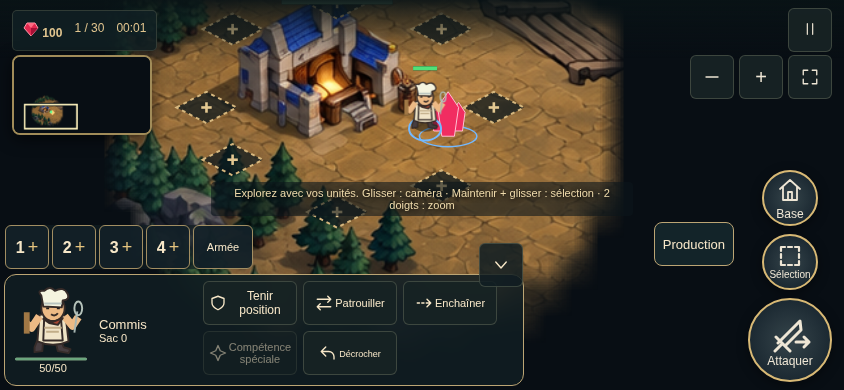

# Issue #95 — Icônes lisibles au pouce

Les icônes de commande mesurent 18 px en CSS, et 24 px dans les boutons ronds et le menu radial. Le rectangle de sélection a des pointillés plus longs et un trait renforcé. L'espacement des actions du panneau est réduit à 2 px pour conserver les retours à la ligne existants.

Les dimensions du panneau et des boutons ronds sont conservées. Les boutons caméra, auparavant de 40 px en paysage, ont désormais un minimum de 44 px pour satisfaire le critère tactile de l'issue.

Capture Chromium avec viewport tactile 844 × 390, partie solo et commis sélectionné. Comparaison avec le CSS précédent : « Tenir position » et « Compétence spéciale » restent sur deux lignes ; « Patrouiller », « Enchaîner » et « Décrocher » restent sur une ligne. Aucun libellé coupé.

Vérifications : dimensions calculées des icônes visibles (18/24 px) et cibles (≥ 44 px) contrôlées dans Chromium ; `node tests/icons-taille.mjs`, tous les fichiers `tests/*.mjs` exécutés avec Node et `node --check` sur chaque fichier `public/game/*.js`.

À tester sur un vrai téléphone : reconnaissance immédiate des icônes au pouce, confort des commandes et du menu radial en paysage.
